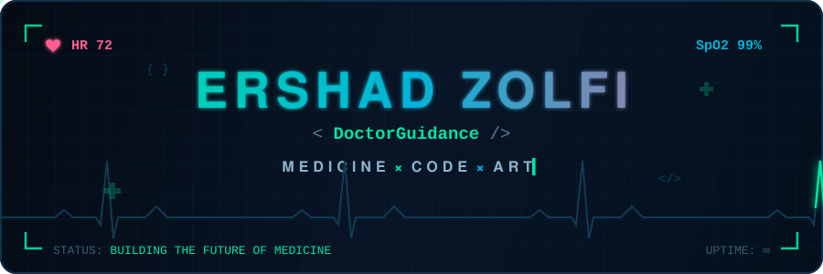
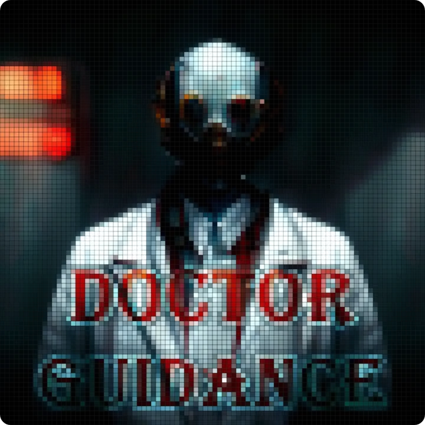
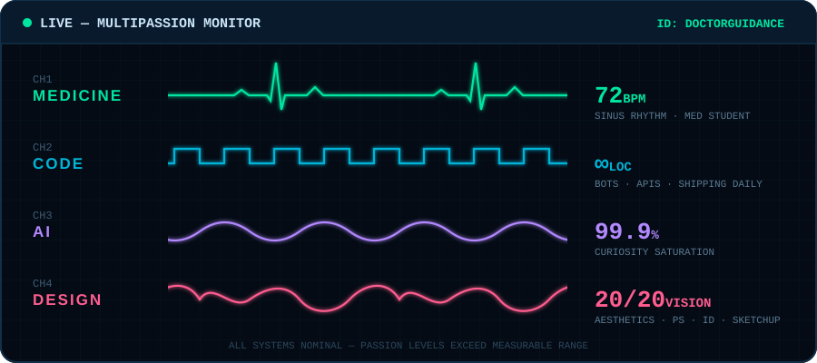

<p align="center">
  
</p>

<p align="center">
  
</p>

<p align="center">
  
</p>

<p align="center">
  <sub><code>CANVAS2D · MOSAIC 8PX · VIGNETTE + BLOOM · WAVE FIELD</code></sub>
</p>

<p align="center">
  <a href="https://instagram.com/ErshadZolfi"></a>
  &nbsp;
  <a href="mailto:ershad.zolfi@gmail.com"></a>
  &nbsp;
  
</p>


## 🩺 `$ whoami`

```yaml
name: Ershad Zolfi (DoctorGuidance)
class: Multi-Passionate Creator
alignment: Medicine × Technology × Art
current_quest: Understanding the human body, one system at a time
side_quests: [Telegram bots, AI experiments, business ventures, design]
recharge_ritual: [gaming 🎮, movies 🎬, declamation 🎙️, clouds ☁️, cats 🐈, cosmos 🌌]
rare_trait: Introverted, meticulous Beholder 👁️
```

I live at the intersection where a **stethoscope meets a terminal** — studying medicine by day, shipping code and ideas by night, and finding beauty in both.

<p align="center">
  
</p>


## 📡 Live Vitals

<p align="center">
  
</p>


## ⚡ Tech Arsenal

### Languages & Frameworks

<p align="center">
  
</p>

### Infra, Data & AI

<p align="center">
  
</p>

### Design & Creative

<p align="center">
  
</p>


## 🚀 Open Source Core Engineering & Impact

<p align="center">
  <a href="https://github.com/MHSanaei/3x-ui/pull/7044"></a>
  &nbsp;
  <a href="https://github.com/fastify/fastify-compress/pull/442"></a>
  &nbsp;
  <a href="https://github.com/fastify/fastify-cookie/pull/384"></a>
  &nbsp;
  <a href="https://github.com/fastify/fastify-static/pull/623"></a>
  &nbsp;
  <a href="https://github.com/fastify/fastify-cors/pull/427"></a>
  &nbsp;
  <a href="https://github.com/elysiajs/elysia/pulls?q=author:DoctorGuidance"></a>
</p>

| Target Project | Focus & Technical Impact | Status |
| :--- | :--- | :---: |
| [**MHSanaei/3x-ui**](https://github.com/MHSanaei/3x-ui) | Subscription token parser & single-bracket token mapper | 🟣 [Merged #7044](https://github.com/MHSanaei/3x-ui/pull/7044) |
| [**fastify/fastify-compress**](https://github.com/fastify/fastify-compress) | Inherit global options when route options are partially defined | 🟢 [Open #442](https://github.com/fastify/fastify-compress/pull/442) |
| [**fastify/fastify-cookie**](https://github.com/fastify/fastify-cookie) | Standalone `parse` and `serialize` synchronous ESM resolution | 🟢 [Open #384](https://github.com/fastify/fastify-cookie/pull/384) |
| [**fastify/fastify-static**](https://github.com/fastify/fastify-static) | Directory index root priority order resolution (`wildcard: false`) | 🟢 [Open #623](https://github.com/fastify/fastify-static/pull/623) |
| [**fastify/fastify-cors**](https://github.com/fastify/fastify-cors) | RFC 7230 Vary header optional whitespace (OWS) tokenizer compliance | 🟢 [Open #427](https://github.com/fastify/fastify-cors/pull/427) |
| [**elysiajs/elysia**](https://github.com/elysiajs/elysia) | Bun adapter headers preservation (Array subclasses), RPC context params, WeakMap listener cleanup | 🟢 [4 PRs Active](https://github.com/elysiajs/elysia/pulls?q=author:DoctorGuidance) |
| [**typeorm / knex / sequelize**](https://github.com/DoctorGuidance) | SQL dialect query generation edge cases, migration schemas, and driver stability | 🟢 [12 PRs Active](https://github.com/DoctorGuidance) |


## 📊 Lab Results

<p align="center">
  
</p>

## 🫀 Contribution ECG

<p align="center">
  
</p>


<p align="center">
  <sub>🩺 <b>Rx:</b> One meaningful commit daily. Take with curiosity. Refills: unlimited.</sub>
</p>

<p align="center">
  <b><code>while (alive) { learn(); build(); heal(); }</code></b>
</p>
